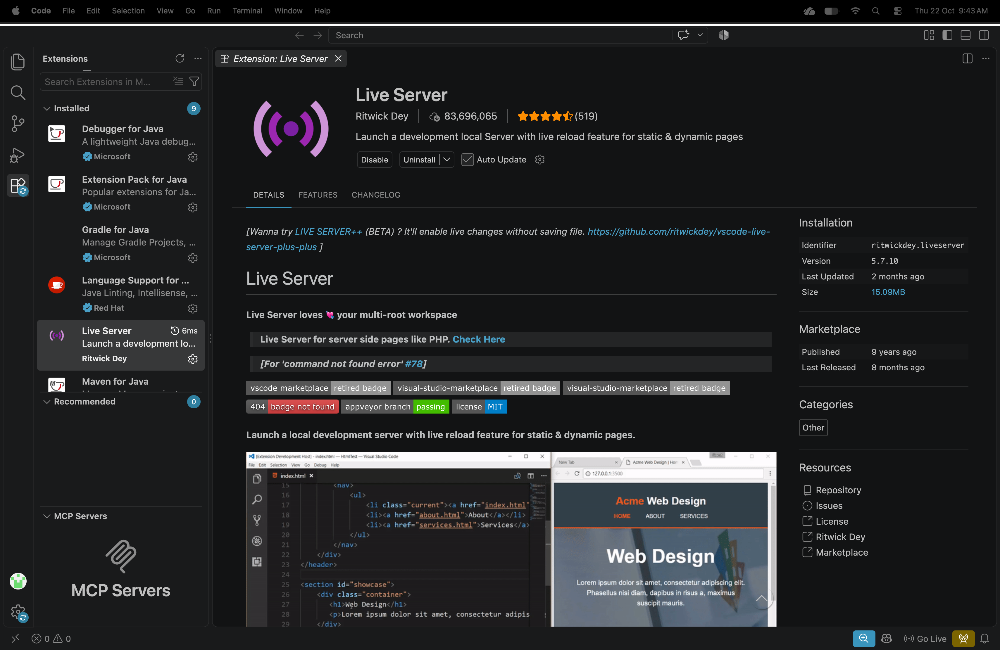

# Ques 02: Install VS Code, Node.js, and Live Server?
Ans:Step 01: VS Code – open it, then Help → About (note the version).
Step 02:Live Server – Extensions panel (Ctrl+Shift+X) → search Live Server by Ritwick Dey → Install. Open any .html file → right-click → Open with Live Server (or click Go Live in the status bar).
Step 03: Arrange the window so that VS Code, the terminal output (node -v), the Live Server extension and the browser tab running on.
